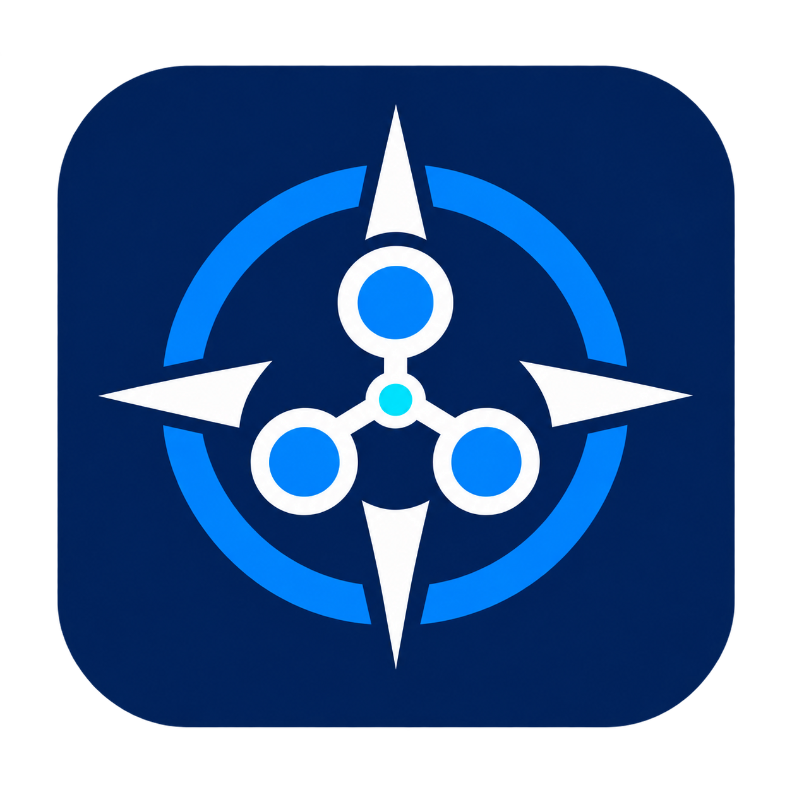

<div align="center">
  
  <h1>Talos Pilot</h1>
  <p>A local desktop cockpit for Talos Linux and Kubernetes.</p>

<a href="https://github.com/agiledevel/talos-pilot/blob/main/package.json"></a>
<a href="https://github.com/agiledevel/talos-pilot/actions/workflows/check.yml"></a>
<a href="https://github.com/agiledevel/talos-pilot/actions/workflows/security.yml"></a>
<a href="https://github.com/agiledevel/talos-pilot/actions/workflows/release.yml"></a>
</div>

Talos Pilot is being built to bring cluster infrastructure and Kubernetes workloads into one desktop application. The planned v1 covers creating clusters on machines in Talos maintenance mode, inspecting nodes and workloads, managing resources and Helm releases, performing guided upgrades, and backing up and recovering clusters.

**Current stage: foundation development, milestone 1; completion is not yet verified.** The application has a Svelte/Skeleton desktop shell, typed IPC, a supervised Go helper, encrypted backend storage, native credential import, a bounded Talos read probe, and a Kubernetes Pod list with a Workloads view. F0 added enforced contract drift checks. F1 is closed: it refreshed Talos to v1.14.2, proved reader/denied identities through the production path, and implemented bounded mid-stream reconnect/resync with replacement-snapshot generations. Six live rows passed against a disposable Talos v1.14.2/Kubernetes v1.36.5 fixture on 2026-10-12, including a reboot interruption recovering under generation 2 with a continuous sequence. Live retry exhaustion has no fixture evidence: the owner re-scoped that row. F1a's bounded stall detection has deterministic helper tests, while its live stall and exhaustion row remains unexecuted. F2, the Rust Kubernetes client and credential-session boundary, is accepted. F3 now has a real admin mTLS `/version` preflight and one Rust list through the restricted reader on the disposable Kubernetes v1.36.5 fixture: 201 unique Pods across two pages, a complete snapshot with a resource version, followed by verified namespace cleanup and host restoration. Deterministic tests cover the 10,000-object partial cap; no live cap run exists because the allowlist authorizes exactly 201 Pods. F4 is accepted on Linux: it has session-owned bounded watch recovery, acknowledged Tauri delivery, renderer validation, shared-query ownership and stale/reconnect state; synthetic tests cover the list/watch handoff, 410 relists, queue and transport bounds, and cancellation during list, relist, and backoff. Native Tauri tests prove ordered delivery, closed-consumer acknowledgement timeout, session close, and active-watch shutdown cleanup. A real Kubernetes 1.36 watch received add, status change, delete, same-name recreation, and a resumed event after an endpoint connection reset. The [resource-baseline matrix](docs/verification/kubernetes-watch-resource-baseline.md) and [ledger entry](docs/plans/foundation-finish/ledger.md) record evidence by acceptance case. F6/document 05 has a 65,536-byte UTF-8 document ceiling and bounded one-in-flight/one-latest validation, and is accepted on Linux: the initial editor/diff/CSP/cleanup evidence is followed by three P2 corrective cases that preserve owning drafts across rejected replacements and reopen, restore rejected-edit inline markers and release rejected initial options. The [F6 evidence](docs/verification/f6-editor-workers-csp.md) labels browser and native rows separately. F5 still needs the Kubernetes 1.35/1.37 version matrix; the F7 terminal/chart wrappers, package/platform qualification, installed-package rows, and measured performance budgets also remain open. The [readiness review](docs/verification/foundation-readiness-2026-10-11.md) records earlier source findings; the [milestone 1 ledger](docs/verification/milestone-1.md) and [foundation finish ledger](docs/plans/foundation-finish/ledger.md) distinguish executed evidence from pending acceptance. Preview packages do not establish complete v1 qualification; the scope remains the [locked design](docs/design.md).

**Review baseline, 2026-10-25 (`889157f`):** `pnpm check:ci` passed (191 tests, zero Svelte errors/warnings, production frontend build), but two fresh `pnpm test:e2e` runs failed: 14/16 and 15/16 passed. Menu keyboard focus/selection failed in both; editor reset timed out in the first. First-run traces showed an unexpected page reload; its cause is not established. Document 05 is reopened for browser stabilization and editor input/worker bounds before F7. C7 also remains in progress for generated/packaged notices and F8 security refresh. Earlier native/fixture passes remain attributed evidence, not fresh results from this review. Follow the [LLM follow-up plan through owner review and M2.0](docs/plans/foundation-finish/follow-up-to-m2.md), starting at S0. No milestone 2 feature work was unblocked by that review.

**Current S0/S1 disposition, 2026-10-25:** S0 is [accepted by owner-directed exception after a real native keyboard pass](docs/verification/s0-native-keyboard-acceptance.md); B11 remains unresolved/not fixed, with browser assertions and diagnostics retained. S1 and document 05 are **accepted and done on Linux**, including the three P2 corrections. The subsequent [normalized-model bounds correction](docs/plans/foundation-finish/s1-normalized-bounds-correction.md) has fresh Linux local qualification, with its hosted disposition tracked in the ledger. The [S1 launch prompt](docs/plans/foundation-finish/s1-launch-prompt.md) is now historical, and the [ledger](docs/plans/foundation-finish/ledger.md) records the final review, gates and hosted results. Document 06/F7 (S2) is next and has not started. Linux foundation acceptance for the remaining packets, the later owner review and M2.0 remain gated.

The [foundation completion FLASH plan](docs/plans/foundation-completion-flash.md) remains the normative definition of the remaining packets, which are worked through the [foundation finish series](docs/plans/foundation-finish/README.md); its [ledger](docs/plans/foundation-finish/ledger.md) names the next document and records each session. The owner has no macOS or Windows machine and decided on 2026-10-12 that milestone 1 may stay open for those platform rows without blocking further development: they are deferred, recorded as unexecuted, and revisited when the platforms are available. The development host has root and KVM; each fixture session applies the owner-approved fixture-scoped host remediation and removes it again. The [original milestone 1 plan](docs/plans/milestone-1-flash.md) retains its acceptance matrix. The prepared [milestone 2 FLASH plan: Connections and read views](docs/plans/milestone-2-flash.md) defines the next milestone's implementation packets and tests; feature implementation starts once the series is done on Linux.

## What Talos Pilot is building

- **Talos lifecycle:** maintenance onboarding, upstream configuration generation and validation, bootstrap, node management, upgrades, diagnostics, backup, and recovery.
- **Kubernetes management:** workloads, networking, storage, access policies, custom resources, logs, container terminals, port forwarding, metrics, and Helm.
- **Guided operations:** explicit target review, preflight checks, progress, per-target results, and interruption/recovery handling.
- **Local credentials:** backend-owned API clients and encrypted storage, direct access over your LAN or existing VPN, and no hosted control service.

These are product commitments under development. Their acceptance criteria and milestone order are in the [design](docs/design.md) and [quality standards](docs/quality.md).

## Architecture

| Layer               | Technology and responsibility                                                                                                              |
| ------------------- | ------------------------------------------------------------------------------------------------------------------------------------------ |
| Desktop and backend | Tauri 2, Rust, Tokio; native application services and ordinary Kubernetes access                                                           |
| Interface           | Svelte 5, strict TypeScript, Skeleton with Bits UI, Tailwind CSS; bounded application projections through typed IPC                        |
| Talos and Helm      | A bundled Go helper using official upstream APIs and SDKs, introduced during foundation work                                               |
| Development         | Vite 8, pnpm, Oxlint with type diagnostics, Oxfmt, svelte-check                                                                            |
| Verification        | Renderer tests, browser accessibility flows, native/platform checks, and disposable cluster fixtures as their capabilities are implemented |

The renderer does not own cluster credentials or connect directly to cluster APIs. The [dependency research](docs/dependencies.md) records exact versions and primary sources; package and Cargo lockfiles are committed.

## Run from source

Install **Node 26.12.1**, **pnpm 12.15.0**, **Rust 1.99.1**, **Go 1.27.3**, and the [Tauri native prerequisites](https://v2.tauri.app/start/prerequisites/) for your OS. Node and Rust are pinned in `.node-version` and `rust-toolchain.toml`; Go is pinned by `helper/go.mod`. The checked-in [toolchain bootstrap](scripts/dev-toolchain.ts) downloads Node, pnpm, and protoc into the gitignored `.tools/` directory, verifies every archive against its published SHA-256, and checks the pinned Go, Rust, and `talosctl` versions without installing anything system-wide.

```sh
git clone https://github.com/agiledevel/talos-pilot.git
cd talos-pilot
node scripts/dev-toolchain.ts    # host Node 22 or newer; provisions .tools/
export PATH="$PWD/.tools/node/bin:$PWD/.tools/protoc/bin:$PWD/.tools/bin:$PATH"
pnpm install --frozen-lockfile
pnpm desktop:dev
```

After the first bootstrap, `pnpm toolchain:bootstrap` re-verifies the same pins. Linux x86_64, macOS arm64, and macOS x64 are supported; other hosts use the manual procedure in the [close-out plan](docs/plans/foundation-finish/closeout-plan.md#5-host-and-toolchain-bootstrap).

Use `pnpm dev` for the browser shell at `http://127.0.0.1:1420`. Appearance preferences last for the current session. Native builds target Linux x86_64, macOS 13.3 or later (Apple Silicon and Intel, per [0010](docs/decisions/0010-macos-minimum-webview.md)), and Windows x86_64; configured CI targets are distinct from verified operating-system compatibility.

## Quality checks

```sh
pnpm check                         # format, lint/types, Svelte diagnostics, unit tests, frontend build
pnpm check:ci                      # same aggregate; one coverage-enabled unit run (matches CI)
pnpm format:rust:check             # rustfmt check (pnpm format:rust applies it)
pnpm test:coverage                 # coverage reports, including LCOV
pnpm exec playwright install chromium
pnpm test:e2e                      # browser shell layout, appearance, and accessibility
pnpm production:check              # default native build excludes test-only surfaces
pnpm advisories:check              # recorded advisory applicability still matches scan, path, binary
pnpm audit:go                      # pinned govulncheck over the helper module graph
pnpm inventory:check               # generated dependency/license inventory is current
pnpm talos:fixture -- --manifest tests/fixtures/talos-c4.json --talosconfig <path>
                                   # live C4 harness against the allowlisted disposable fixture
pnpm test:native                   # embedded WebDriver IPC, helper handshake, and denial checks (manual/weekly native workflow or local)
pnpm icons:check                   # deterministic desktop icon conversion
pnpm contracts:check               # generated Rust/Go/TypeScript contracts are current
pnpm desktop:build                 # builds the target helper and native release executable
```

[GitHub Actions](.github/workflows/check.yml) runs renderer checks, Playwright mock flows, Rust formatting, Clippy, tests, rustdoc, builds, and dependency scans across the desktop build matrix. Pull requests run three of the four desktop runners and skip the matrix for a documentation-only push; pushes to `main` and release qualification run all four ([0014](docs/decisions/0014-ci-scope-and-caching.md)). Native WebdriverIO is assigned to a manual and weekly `Native tests` workflow and to release qualification; live fixtures, clean-VM package smoke, and performance measurement run locally or in explicit manual workflows ([0016](docs/decisions/0016-ci-test-tiering.md)). The [security scans](.github/workflows/security.yml) run CodeQL on the workflows, TypeScript, and Rust, and Trivy on dependencies, secrets, and misconfigurations. Each fails on any finding. [Decision 0018](docs/decisions/0018-ci-feedback-and-cache-budgets.md) adds conservative PR reuse of unchanged executed evidence, bounded Ubuntu provisioning and dependency caches, cached Chromium/pnpm tools, one coverage-enabled renderer suite, and parallel release compilation. Main/manual/scheduled/release qualification remains full; reused checks are not fresh executions. Workers follow [FLASH pace](docs/flash-pace.md). The pre-Session-B CI implementation/PR/local handoff is verified. Session B recorded document 05's offline editor/worker feasibility with actual native Tauri evidence under the packaged CSP. The 2026-10-25 review reopened its browser/bounds follow-up; the [foundation finish ledger](docs/plans/foundation-finish/ledger.md) and [follow-up plan](docs/plans/foundation-finish/follow-up-to-m2.md) put S0/S1 before document 06. Remaining post-merge entry-point, release, installed-package and platform qualification stays explicitly open in that ledger. Badges above report live checks; they are not a claim that every planned feature is qualified.

See the [initialization evidence](docs/verification/initialization.md) and [automation evidence](docs/verification/automation.md) for executed environments and limitations. The two GLib/macro dependency advisories inherited from Tauri's Linux GTK3 stack carry a verified applicability decision in [0006](docs/decisions/0006-gtk3-advisory-applicability.md); Trivy has two exceptions, for the tracked GLib advisory and for the unlinked `golang.org/x/crypto/openpgp` deprecation notice (GO-2026-5932), and both expire on 2026-11-30. `pnpm test:native` and `pnpm desktop:build` share the release executable path, so rebuild with `pnpm desktop:build` before `pnpm production:check` or `pnpm advisories:check`. Setup is in [CI/release](docs/ci-release.md).

## Preview releases

The [release workflow](.github/workflows/release.yml) starts when a version tag is pushed or when an existing tag is selected through **Actions → Release preview → Run workflow**. It validates matching npm/Tauri/Cargo versions and main-branch ancestry, runs QA, the native workflow, and the CodeQL/Trivy security scans on the exact commit, builds packages for all four desktop targets, generates Angular-commit release notes, and creates a **draft prerelease** with SHA-256 asset hashes.

Linux assets are AppImage, DEB, and RPM; macOS assets are separate Apple Silicon and Intel DMGs; Windows uses an NSIS installer. Current previews are development packages without production signing/notarization. Full production releases require the complete release qualification in [quality.md](docs/quality.md).

Read [CI and release setup](docs/ci-release.md) for repository settings, release commands, and failure recovery. The [changelog](CHANGELOG.md) is generated with the committed `cliff.toml` configuration.

## Contributing

Follow [AGENTS.md](AGENTS.md), the [quality standards](docs/quality.md), and the relevant development skills under [.agents/skills](.agents/skills). Use Angular semantic commits, such as `feat(clusters): add connection validation` or `fix(talos): preserve target identity`. Keep architecture decisions, tests, and documentation together with the behavior they explain.
